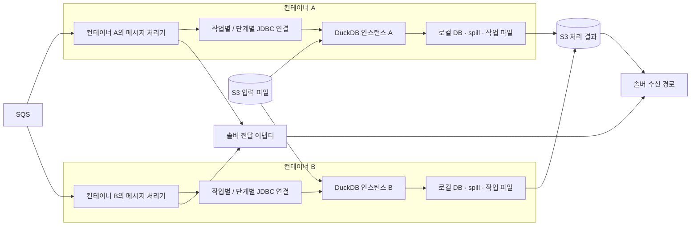
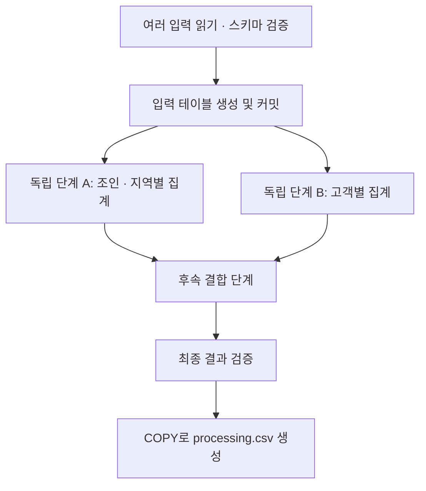

# Kotlin · DuckDB · jOOQ 기반 SQS 데이터 처리 파이프라인 프로덕션 설계

작성일: 2026-11-01  
대상: Kotlin / Spring Boot, SQS, S3, Docker / Kubernetes 환경  
설계 버전: 1.2 — 기존 시스템의 멱등성 반영  
상태: SQS 재전달 기반 프로덕션 설계 기준선. 기존 시스템은 재처리·중복 전달에 멱등하며 이를 확정된 전제로 사용한다. workload 수치와 구체적인 연결 설정, 구현·부하 검증은 출시 전 필요하다.

이 문서는 수백 MB~GB 규모의 여러 입력 파일을 읽고, 조인·집계·행별 계산과 중간 결과 재사용을 거쳐 솔버용 `processing.csv`를 만드는 파이프라인의 적용 기준이다. 현재 Kotlin DataFrame 구현을 비교 대상으로 삼되, DuckDB 전환에 따른 속도 향상은 실제 결과와 처리 시간을 비교한 뒤 판단한다.

구체적인 DAG와 동시에 실행할 단계는 아직 정해지지 않았다. 실행 엔진의 계약은 이 문서에서 확정하고, 단계 정의·입력 상한·동시성·시간 예산은 버전 관리되는 workload profile로 주입한다. 예시 수치는 운영 권장값이 아니다. 운영 profile의 필수값이 비어 있으면 워커는 수신을 시작하지 않는다.

문서에서 **필수**는 현재 처리 계약을 성립시키는 조건, **기본 선택**은 제안하는 구현 기준선, **예시**는 교체 가능한 설명값이다. 1~12절은 계산 구조와 코드 경계, 13~18절은 전달·복구·실행 제어, 19~23절은 자원·배포·운영, 24~26절은 검증·구현·설계 범위를 다룬다.

**정정:** 이전 버전에서 PostgreSQL JobStore·outbox 발행기·reconciler를 필수로 추가한 것은 합의된 요구를 넘어선 설계였다. 이번 버전은 작업 완료 전 원본 SQS 메시지를 삭제하지 않고, 장애 복구는 SQS 재전달로 수행한다. 별도 제어 DB나 복구 서비스는 기본 구성에 포함하지 않는다.

## 1. 적용 방향과 확정한 요구사항

| 항목 | 적용 기준 |
|---|---|
| 실행 계기 | SQS 메시지를 수신하면 작업을 실행한다. HTTP 요청이나 애플리케이션 시작 시 일회성 실행을 전제로 하지 않는다. |
| 입력 | S3의 여러 CSV. 생산 단계의 형식을 바꿀 수 있다면 Parquet도 지원한다. |
| 계산 구조 | 여러 단계가 분기하고 다시 합쳐지는 DAG. 중간 결과를 여러 후속 단계에서 재사용한다. |
| 계산 엔진 | 대량 데이터의 조인·집계·정렬·행별 계산은 DuckDB에서 실행한다. |
| 코드 작성 | 안정된 테이블 스키마에 대해 생성한 jOOQ DSL로 업무 계산을 작성한다. |
| Kotlin의 역할 | 작업 수명 관리, SQS 처리, 단계 실행, 파일 입출력 연결, 결과 전달, 관측과 정리. |
| 최종 산출물 | DuckDB가 `processing.csv`를 직접 생성한다. 솔버는 전달 계약에 따라 이 파일을 사용한다. |
| 배포 | 여러 컨테이너가 실행될 수 있다. 각 컨테이너는 자신의 DuckDB 인스턴스와 작업 저장소를 가진다. |
| 메시지 동시 처리 | 지원한다. 동시 처리 수를 1로 고정하지 않는다. |
| 메시지 내부 병렬성 | DuckDB 쿼리 내부 병렬 실행과, DAG의 독립 단계 동시 실행을 모두 고려한다. |
| 자원 정리 | 각 작업의 성공·실패 종료 시 해당 작업의 파일·테이블·연결을 정리한다. |

**컨테이너당 DuckDB 인스턴스 하나라는 설계는 JDBC 연결 하나 또는 동시 메시지 하나를 뜻하지 않는다.** 여러 연결이 하나의 인스턴스를 공유하면서 작업을 동시에 실행한다.

### 프로덕션 기본 선택과 불변 조건

| 결정 | 기본 선택 / 반드시 지킬 조건 |
|---|---|
| 계산 워커 | 한 Pod의 워커 프로세스에 DuckDB 인스턴스 하나. 여러 메시지와 독립 DAG 분기를 제한된 자원 안에서 병렬 실행한다. |
| 장애 범위 | 스키마는 데이터 이름만 격리한다. 네이티브 장애·OOM은 워커 전체에 영향을 줄 수 있으며 그 안의 작업은 재시도할 수 있어야 한다. |
| 복구 상태 | 삭제되지 않은 원본 SQS 메시지가 재실행의 근거다. 별도 JobStore를 필수로 두지 않는다. |
| 메시지 역할 | 처리 중 visibility를 연장하고, 결과의 영속 저장과 합의한 downstream 전달 성공 후에만 ack한다. 실패하면 삭제하지 않는다. |
| 결과 저장·전달 | 실행별 S3 객체 업로드를 끝낸 뒤 해당 객체를 솔버 전달 경로에 넘긴다. 실제 전송 성공을 확인하기 전에 입력 메시지를 삭제하지 않는다. |
| 전달 보장 | 기존 시스템은 재처리·중복 전달에 멱등하므로 같은 작업을 여러 번 처리하거나 전달해도 문제없다. 파이프라인에 별도 중복 방지 저장소를 추가하지 않는다. |
| 중간 결과 | 재시작 후 이어서 실행하지 않고 입력부터 다시 계산한다. 초기 버전에는 분산 DAG·영구 중간 체크포인트를 넣지 않는다. |
| 자원 경계 | CPU·메모리·디스크는 Pod 단위 예산. job/stage 제한과 admission으로 부하를 제어하되 완전한 작업별 메모리 격리를 보장하지 않는다. |
| 완료 의미 | worker 성공은 CSV 저장과 합의된 전달 경로의 성공 응답까지다. 솔버 계산 완료와 로컬 cleanup 성공은 별개다. |

이 기본 선택은 신뢰된 내부 계산과 재현 가능한 입력을 전제로 한다. 사용자 임의 SQL, 서로 신뢰하지 않는 tenant의 실행, 단일 워커 자원을 초과하는 계산은 별도 실행 환경이나 다른 엔진이 필요하다. 서로 다른 자원 특성은 workload profile별 큐·워커 풀로 분리할 수 있다.

## 2. 전체 구조



S3는 입력과 생성 완료된 출력의 공유 지점이다. 로컬 DuckDB DB 파일과 spill 디렉터리는 컨테이너별로 분리한다. 다른 컨테이너가 같은 로컬 DB 파일을 쓰는 구조를 이 설계에 포함하지 않는다.

작업 내부 DAG는 다음과 같이 표현할 수 있다. 실제 단계 이름과 계산식은 기존 로직으로 대체한다.



독립 단계 A와 B는 동시에 실행할 수 있다. 후속 결합 단계는 두 단계의 성공과 커밋이 모두 확인된 뒤 실행한다.

## 3. 작업 식별자와 재실행 기준

업무상 같은 작업인지 판단하는 키와, 실제 실행 한 번을 식별하는 키를 구분한다.

| 식별자 | 예 | 용도 |
|---|---|---|
| `jobKey` | 기존 시스템의 작업 식별 계약에 맞춘 키 | 재시도 간 동일 작업 추적과 기존 멱등 처리 연계. 새로운 중복 방지 체계를 만들지 않는다. |
| `attemptId` | 실행마다 생성하는 UUID | 로컬 파일·DB 스키마 격리, 실패 추적 |
| SQS message ID | SQS가 부여하는 ID | 수신 추적. 업무 멱등성 키 전체를 대체하지 않는다. |

메시지는 파일 데이터 자체보다 입력 위치와 버전을 담는다. 최소한 다음 정보를 전달한다.

```json
{
  "jobId": "planning-20261101-001",
  "pipelineVersion": "v1",
  "inputs": [
    {
      "name": "orders",
      "uri": "s3://input-bucket/datasets/dataset-v42/orders.parquet",
      "schemaVersion": "orders-v1"
    },
    {
      "name": "customers",
      "uri": "s3://input-bucket/datasets/dataset-v42/customers.parquet",
      "schemaVersion": "customers-v1"
    }
  ]
}
```

입력은 버전이 고정된 키 또는 manifest로 식별한다. 재시도 중 같은 경로의 내용이 바뀌면 동일 작업을 재현할 수 없다. S3 Version ID를 사용할 때는 선택한 읽기 경로가 그 버전을 실제로 읽는지 확인한다. ETag를 모든 객체의 MD5라고 간주하지 않는다.

SQS Standard는 중복 전달될 수 있다. `jobKey`는 재수신에도 유지하고 `attemptId`는 각 실행마다 새로 만든다. 같은 jobKey의 재계산과 동시 실행이 일어날 수 있으므로 로컬 스키마·파일과 S3 출력은 attempt별로 격리한다. visibility를 분산 락으로 취급하지 않는다. [SQS 전달 보장][sqs-delivery]

위 JSON은 입력 목록의 축약 예시다. 실제 메시지에는 계산 파라미터·pipeline/output contract 버전 등 재현에 필요한 값을 담는다. 13~15절에서 ack와 결과 재전달 계약을 정의한다.

## 4. DuckDB 인스턴스·연결·스키마의 수명

| 대상 | 수명 / 소유자 | 운영 규칙 |
|---|---|---|
| DuckDB 인스턴스 | 컨테이너의 워커 프로세스 | 여러 JDBC 연결이 공유한다. |
| 기준 연결 `anchor` | 워커 시작부터 정상 종료까지 | 인스턴스를 유지하고 초기 설정을 적용한다. 업무 쿼리를 동시에 실행하는 공용 연결로 사용하지 않는다. |
| 작업 / 단계 JDBC 연결 | 해당 작업 또는 단계 실행 중 | 동시에 실행하는 쿼리는 연결을 분리한다. 사용 후 실제로 닫는다. |
| `DSLContext` | 연결과 작업 설정에 종속 | 현재 연결과 작업 스키마를 사용하도록 생성한다. 하나의 연결에 묶인 싱글턴 DSLContext로 모든 작업을 처리하지 않는다. |
| 일반 테이블 | 생성된 DB 인스턴스 / DB 파일 | 같은 DB의 다른 연결이 커밋된 데이터를 읽을 수 있다. 작업별 스키마로 격리한다. |
| `TEMP TABLE` | 생성한 연결 | 다른 연결에서 볼 수 없다. 연결 종료 시 삭제된다. |
| 작업 디렉터리 | `attemptId` | 로컬 입력 사본·출력 파일을 저장하고 작업 종료 시 삭제한다. |

`DuckDBConnection.duplicate()`는 같은 인스턴스에 새 연결을 만든다. 매번 독립적인 `jdbc:duckdb:` 연결을 새로 만들면 서로 다른 인메모리 인스턴스가 생길 수 있으므로, 공유하려면 기준 연결에서 파생시키는 의도를 코드에 드러낸다. [DuckDB JDBC 연결][duckdb-jdbc]

이 문서의 기본 예제는 로컬 파일 기반 DB를 사용한다.

```text
jdbc:duckdb:/scratch/<workerBootId>/duckdb/worker.duckdb
```

일반 테이블이 파일에 저장되더라도 이 파일을 영구 업무 데이터의 원본으로 취급하지 않는다. 입력은 S3에서 다시 읽을 수 있고, 확정된 결과와 완료 상태는 외부에 보관한다.

## 5. 병렬 실행과 중간 결과 공유

### 5.1 세 가지 병렬성을 따로 제어한다

| 수준 | 제어 항목 | 의미 |
|---|---|---|
| 여러 메시지 | `maxConcurrentMessages = C` | 한 리스너가 큐별로 동시에 처리하는 메시지 수 |
| 한 메시지의 독립 단계 | 단계 실행기와 DAG 의존성 | 선행 조건이 끝난 서로 독립적인 단계를 함께 실행 |
| 한 SQL 내부 | DuckDB `threads = T` | 조인·스캔·집계 등에 사용하는 인스턴스의 실행 스레드 설정 |

같은 인스턴스에 연결된 쿼리는 네이티브 실행 풀을 공유한다. `C=4`, `T=4`가 각 메시지에 전용 CPU 스레드 4개씩을 보장하는 것은 아니다. 애플리케이션 스레드와 I/O 관련 스레드 수도 별도로 존재한다. [DuckDB 스레드와 풀][duckdb-jdbc]

메시지 내부 분기를 병렬 실행한다면 애플리케이션 전체에서 동시에 실행할 JDBC 작업 수 `Q`도 정한다. 예를 들어 메시지 4건이 각각 분기 2개를 가진다고 해서 제한 없이 모든 하위 작업을 시작하지 않는다. **동시성 제한은 자원 예산에 맞춰 조정하는 값이며, 1이라는 고정 제약이 아니다.**

단계 실행기는 제한된 스레드 수와 대기열을 사용한다. 이미 큐에서 받은 메시지를 무제한 내부 대기열에 쌓으면 visibility timeout이 계산 시작 전에 소모될 수 있다. SQS 수신 동시성과 단계 실행기의 처리 능력을 함께 조정한다.

### 5.2 메시지 내부 분기에는 작업별 스키마를 사용한다

```text
worker.duckdb
├─ job_7d5c...       # attempt A
│  ├─ orders
│  ├─ customers
│  ├─ region_totals
│  └─ customer_totals
└─ job_b421...       # attempt B
   ├─ orders
   ├─ customers
   ├─ region_totals
   └─ customer_totals
```

스키마 이름은 UUID 등 애플리케이션이 생성한 안전한 식별자로 만든다. 입력 테이블을 만든 뒤 커밋하고, 분기마다 별도 연결을 열어 같은 작업 스키마를 사용한다. 각 분기는 서로 다른 출력 테이블을 소유하며, 완료된 입력 테이블은 후속 단계가 읽기만 한다.

여러 연결에 걸쳐 재사용하는 중간 결과는 일반 테이블에 저장한다. 한 연결 내부에서만 쓰는 임시 계산에는 `TEMP TABLE`을 사용할 수 있다. TEMP TABLE의 연결 범위와 일반 테이블의 커밋 가시성을 혼동하지 않는다. [DuckDB 테이블 수명][duckdb-create-table]

| 중간 결과 표현 | 적용할 때 |
|---|---|
| CTE | 한 SQL 안에서 계산을 조합한다. 다른 SQL이나 연결이 재사용할 저장소는 아니다. |
| VIEW | 계산 정의를 재사용한다. 결과를 미리 저장하는 materialized table로 취급하지 않는다. |
| TEMP TABLE | 하나의 연결에서 여러 SQL이 결과를 재사용한다. |
| 작업 스키마의 일반 테이블 | 여러 연결의 분기·후속 단계가 결과를 재사용한다. |

CTE의 실제 materialization이나 inline 여부는 실행 계획의 영향을 받으므로, CTE라는 이유만으로 항상 한 번 계산되거나 항상 다시 계산된다고 단정하지 않는다.

작업 전체를 하나의 긴 트랜잭션으로 감싸면서 다른 연결의 분기가 미커밋 데이터를 볼 수 있다고 가정하지 않는다. 단계별 생성·삽입을 커밋한 뒤 의존 단계를 시작한다. Spring의 스레드에 연결된 트랜잭션도 다른 실행기 스레드로 자동 전파된다고 가정하지 않는다.

### 5.3 단계 실행기의 필수 동작

1. 의존 단계가 모두 성공한 작업만 제출한다.
2. JDBC 연결과 `DSLContext`는 실행되는 단계가 소유한다.
3. 조정자가 분기 완료를 기다리는 동안, 같은 제한된 풀을 점유해 하위 작업이 실행되지 못하는 구조를 피한다.
4. 한 분기가 실패하면 실행 중인 다른 분기의 취소를 요청하고 실제 종료까지 확인한다.
5. 모든 단계가 멈추기 전에 스키마나 파일을 삭제하지 않는다.

구현은 별도의 조정자와 JDBC 단계 실행기를 사용하거나, 완료 콜백으로 다음 DAG 노드를 실행한다. JDBC 호출은 블로킹이므로 coroutine을 사용하더라도 실제 DB 실행을 무제한으로 늘리지 않는다. `Statement.cancel()` 등의 취소 동작은 선택한 드라이버 버전과 실제 쿼리에서 검증한다.

### 5.4 DAG 등록 및 실행 계약

업무 모듈은 다음 메타데이터와 생성된 jOOQ 기반 실행 함수를 등록한다. 메시지가 임의 DAG나 SQL을 제출하게 하지 않는다.

| 필드 | 계약 |
|---|---|
| `stageId`, `dependsOn` | 버전 내에서 유일한 단계 ID와 선행 단계 목록. 시작 시 cycle과 누락 의존성을 검증한다. |
| `reads`, `writes` | 읽을 결과와 단독 소유할 출력. 서로 다른 단계가 같은 테이블을 동시에 변경할 수 없다. |
| `materialization` | `INLINE`, `CONNECTION_TEMP`, `SHARED_TABLE`. 다중 연결 재사용은 `SHARED_TABLE`이다. |
| `resourceClass`, `timeout` | 검증된 단계 자원 분류와 실행 시간 한도. 임의 메모리 크기를 정확히 예측한다는 의미가 아니다. |
| `resultContract` | 컬럼·타입·NULL·유일성·행 수 또는 증가율 상한 등 단계별 검증 기준. |
| `consumers` | 결과를 사용할 후속 단계. 마지막 소비자가 실제 종료된 뒤 삭제할 수 있다. |

실행기는 작업별 ready queue를 두고 round-robin으로 단계를 고른다. 각 job에 `maxParallelStagesPerJob` 상한을 두며 전체 실행 중 JDBC 단계는 `Q`를 넘지 않는다. 다음 SQL을 기다리는 조정자는 JDBC 풀을 점유하지 않는다. 완료 콜백에서 다음 단계를 제출하고 ready queue에는 데이터가 아닌 작은 단계 메타데이터만 저장한다. 대기열 상한 도달 시 제출을 늦추며, 거절된 단계를 실행 완료로 표시하지 않는다.

하나의 단계 성공은 **SQL 완료 → 결과 계약 검증 → 커밋 → 완료 알림** 순서다. 커밋 전에는 후속 단계를 시작하지 않는다. 최초 구현의 실패 복구 단위는 전체 attempt다. 일부 테이블을 남긴 채 임의로 실패 단계만 재실행하지 않는다.

분기마다 테이블을 만드는 것과 병렬 실행을 강제하지 않는다. 한 번만 사용하는 계산은 같은 SQL에 합칠 수 있다. 다중 재사용·비싼 재계산·명확한 실패 경계가 있을 때 일반 테이블로 저장한다. 작은 필터·projection을 앞당기고, 큰 조인 두 개의 동시 실행은 profile에서 허용한 경우에만 수행한다.

## 6. JVM과 DuckDB 메모리 예산

DuckDB JDBC는 Java 프로세스 안에서 네이티브 엔진을 실행한다. DuckDB의 계산용 메모리는 주로 JVM 힙 밖에 있으므로 `-Xmx`가 DuckDB 전체 메모리를 제한하지 않는다.

```text
컨테이너 메모리 사용량
  = 실제 JVM 힙 사용량
  + JVM 기타 메모리(메타데이터, 스택, 직접 버퍼 등)
  + DuckDB 네이티브 메모리
  + 기타 네이티브 할당 및 컨테이너에 집계되는 파일 캐시 등
```

| 설정 | 범위 |
|---|---|
| Kubernetes `requests.memory` | 스케줄러가 컨테이너를 배치할 때 사용하는 자원 요청 |
| Kubernetes `limits.memory` | 컨테이너 전체의 메모리 한도 |
| JVM `-Xmx` | Java 힙 최대 크기 |
| DuckDB `memory_limit` | 인스턴스의 버퍼 관리자 메모리 한도 |

같은 DuckDB 인스턴스의 연결들은 `memory_limit`을 공유한다. `6GB`로 설정하고 메시지 네 건을 처리한다고 해서 관리되는 예산이 자동으로 `24GB`가 되지는 않는다. 독립 인스턴스를 여러 개 만들면 각각 별도 예산이 생긴다.

단, `memory_limit` 밖에서 사용하는 데이터 구조와 집계 상태가 있으므로 **이 설정은 DuckDB 전체 사용량의 엄격한 상한이 아니다.** JVM 힙과 DuckDB 한도의 합을 컨테이너 제한에 딱 맞추지 않는다. [DuckDB 메모리 제한][duckdb-memory], [Kubernetes 자원 관리][k8s-resources]

### 초기 측정용 설정 예시

아래 값은 예산 구조를 설명하기 위한 예시다. 실제 데이터에서 검증한 권장 사양은 아니다.

| 항목 | 예시 |
|---|---|
| 컨테이너 CPU | 4 vCPU |
| 컨테이너 메모리 요청 / 제한 | 16Gi / 16Gi |
| JVM 힙 | `-Xms512m -Xmx2g` |
| DuckDB `memory_limit` | `6GB` |
| DuckDB `threads` | `4` |
| SQS 동시 메시지 수 `C` | `4` |
| 애플리케이션 전체 동시 JDBC 단계 수 `Q` | `4` |
| DuckDB spill 한도 | `24GB` |

`Gi`는 Kubernetes의 이진 단위이고 예제 DuckDB의 `GB`는 십진 단위다. 두 값을 같은 바이트 수로 해석하지 않는다. 이 예산에는 JVM 기타 메모리, DuckDB 추가 할당, 파일 캐시와 피크를 위한 여유가 포함된다.

대량 결과를 `fetch()`로 JVM에 가져오지 않으면 힙을 비교적 작게 유지할 수 있다. 최종 크기는 SQS/S3 클라이언트, 업로드 버퍼, 로그와 애플리케이션 자체의 사용량을 포함해 측정한다. 메모리 회수를 위해 `System.gc()`를 호출하는 방식으로 DuckDB를 제어하지 않는다.

계산 중인 단계가 없어도 이전 단계의 테이블·열린 트랜잭션·캐시가 메모리와 디스크를 점유할 수 있다. `Q` 제한만으로 전체 자원 문제가 해결되지 않는다. admission은 활성 job 수 `C`, 보유 중인 중간 결과, 디스크 예약 추정치와 실제 사용량까지 함께 본다. peak가 한도를 넘는 workload는 큰 profile로 보내거나 계산을 바꾸며, 같은 설정으로 무한 재시도하지 않는다.

## 7. 로컬 디스크와 spill

```text
/scratch/<workerBootId>/
├─ duckdb/
│  ├─ worker.duckdb        # 여러 작업이 공유하는 로컬 DB
│  ├─ worker.duckdb.wal    # 생성될 수 있는 복구 로그
│  └─ spill/              # DuckDB가 관리
└─ jobs/
   ├─ attempt-<uuid-a>/   # 이번 실행이 소유한 파일
   └─ attempt-<uuid-b>/
```

`temp_directory`는 메모리가 부족할 때 지원되는 연산이 중간 데이터를 쓰는 위치다. 인메모리 모드에서도 설정할 수 있다. 모든 연산과 모든 데이터 구조가 디스크로 내려갈 수 있는 것은 아니므로, 디스크가 넉넉해도 쿼리가 OOM으로 실패할 수 있다. [DuckDB 메모리 문제][duckdb-oom]

디스크 예산에는 다음을 모두 포함한다.

```text
DB 파일 + WAL + spill + 입력 로컬 사본 + 출력 CSV + 기타 임시 파일
```

`max_temp_directory_size`는 spill 디렉터리에 대한 설정이다. DB 파일, 출력 CSV, 컨테이너 로그까지 포함하는 전체 디스크 한도로 사용하지 않는다. [DuckDB 설정][duckdb-config]

일반 테이블을 `DROP`해도 DB 파일 크기가 즉시 줄지 않을 수 있다. 해제된 블록은 재사용할 수 있으며, 물리적 파일 크기와 DB 내부의 사용 블록을 함께 본다. 작업마다 실행 중인 공용 DB 파일을 삭제하거나 `VACUUM`으로 파일이 줄어들 것이라고 기대하지 않는다. 필요 시 신규 작업 수신을 멈추고 기존 작업을 완료한 뒤 체크포인트·재생성 등의 유지보수를 수행한다. [DuckDB DROP과 공간 재사용][duckdb-drop], [공간 회수][duckdb-space]

## 8. S3 입력과 CSV / Parquet 선택

S3는 저장 위치이고 Parquet는 파일 형식이다. 비교는 `S3의 CSV`와 `S3의 Parquet`, 또는 같은 형식의 S3 직접 읽기와 로컬 사본 읽기로 나눠서 수행한다.

| 조건 | 적용 방향 |
|---|---|
| 생산 단계에서 형식을 선택 가능 | Parquet를 입력 후보로 우선 검토한다. |
| 기존 CSV 유지 필요 | 명시적 컬럼 타입과 파싱 계약으로 DuckDB에 읽어 들인다. |
| 필요한 컬럼·행이 적고 재사용이 적음 | Parquet 직접 조회의 효과를 측정한다. |
| 동일 입력 / 계산 결과를 여러 분기에서 재사용 | 필요한 부분을 작업 테이블에 한 번 저장한 뒤 재사용한다. |
| 원격 파일을 반복 읽는 비용이 큼 | 작업 테이블 적재 또는 버전별 로컬 캐시의 이득을 비교한다. |

Parquet는 타입이 있는 컬럼 형식이고 DuckDB는 필요한 컬럼만 읽거나 필터에 따라 일부 row group을 건너뛸 수 있다. 전체 컬럼과 대부분의 행을 읽는 작업에서는 이 이점이 줄어들 수 있으며, 파일 수·압축·row group 구성과 네트워크도 영향을 준다. 전환 비용과 적재 비용을 포함해 측정한다. [DuckDB Parquet 읽기][duckdb-parquet]

입력 전체를 무조건 모든 단계마다 다시 읽지 않는다. 그렇다고 모든 파일을 무조건 먼저 복제하지도 않는다. DAG에서 재사용하는 경계를 기준으로 materialization을 결정한다.

### S3 인증과 확장 모듈

DuckDB가 S3를 직접 읽는 경로는 `httpfs`와 인증에 필요한 `aws` 확장 모듈을 준비한다. 선택한 DuckDB 버전·CPU 아키텍처와 일치하는 확장 모듈을 컨테이너 이미지에 준비하고, 실행 사용자의 확장 검색 경로도 맞춘다. 매 메시지마다 확장 모듈을 설치하지 않는다.

초기화 SQL 예시:

```sql
LOAD httpfs;
LOAD aws;

CREATE OR REPLACE SECRET pipeline_s3 (
    TYPE s3,
    PROVIDER credential_chain,
    REGION 'ap-northeast-2'
);
```

위 region은 예시이며 실제 버킷에 맞춘다. 애플리케이션용 AWS SDK의 인증 성공만으로 DuckDB 내부 AWS 클라이언트의 인증까지 성공했다고 간주하지 않는다. 실제 배포 환경의 IAM 역할로 DuckDB의 S3 읽기를 확인한다. 장기 실행 워커에서는 임시 자격 증명의 만료와 갱신도 검증하고, 선택 버전이 제공하는 `REFRESH auto` 등을 적용한다. [DuckDB AWS 인증][duckdb-aws], [S3 읽기][duckdb-s3]

## 9. 명시적 스키마와 입력 검증

jOOQ 코드 생성은 선언된 DB 스키마를 기준으로 타입을 제공한다. 실제 파일 내용의 정상 여부는 입력 경계에서 검증해야 한다.

입력 계약에 다음을 포함한다.

- 컬럼 이름·순서·타입, 필수 여부, 허용되는 스키마 버전.
- CSV 구분자·따옴표·인코딩·헤더·NULL 표현, 날짜와 타임존 해석.
- 금액·수량의 정밀도와 반올림 규칙. 필요한 경우 `DECIMAL`을 사용한다.
- 조인 키의 중복 허용 여부와 기대 관계: 1:1, 1:N 등.
- 잘못된 행을 발견했을 때의 처리: 실패, 격리 등. 조용히 누락시키지 않는다.
- 빈 파일과 0행 결과의 업무상 의미.

스키마 계약 예시:

```sql
CREATE SCHEMA pipeline;

CREATE TABLE pipeline.orders (
    order_id BIGINT NOT NULL,
    customer_id BIGINT NOT NULL,
    amount DECIMAL(18, 2) NOT NULL
);

CREATE TABLE pipeline.customers (
    customer_id BIGINT NOT NULL,
    region VARCHAR NOT NULL
);

CREATE TABLE pipeline.region_totals (
    region VARCHAR NOT NULL,
    total_amount DECIMAL(38, 2) NOT NULL
);
```

`NOT NULL`만으로 조인 키 유일성이 보장되지는 않는다. 예를 들어 `customers.customer_id`가 유일해야 하는 업무라면 중복 검증을 통과한 뒤 조인한다. 조인 전후 행 수를 기록해 의도하지 않은 행 수 증가를 발견한다.

스키마를 선언하는 DDL과 반복되는 업무 계산을 분리한다. 업무 계산은 생성된 jOOQ 필드를 사용한다. CSV의 헤더를 검사하지 않은 채 위치 기반 적재가 성공했다는 이유로 입력 계약이 맞다고 판단하지 않는다.

## 10. 의존성과 코드 생성 연결

구현 프로젝트에서 JDK / Kotlin / Spring Boot / Spring Cloud AWS / jOOQ / DuckDB JDBC 버전을 함께 고정한다. 이 문서는 확인되지 않은 최신 버전 조합을 실행 가능한 조합으로 제시하지 않는다.

| 구성 | 의존성 / 설정 |
|---|---|
| DuckDB JDBC | `org.duckdb:duckdb_jdbc` |
| jOOQ 실행 | `org.jooq:jooq` |
| jOOQ 코드 생성 | `org.jooq:jooq-codegen`, `org.jooq:jooq-meta` 또는 대응 Gradle 플러그인 |
| SQS | `io.awspring.cloud:spring-cloud-aws-starter-sqs`와 호환 BOM |
| S3 결과 업로드 | AWS SDK for Java v2 S3 클라이언트 또는 기존 프로젝트의 S3 모듈 |

jOOQ 실행 라이브러리와 코드 생성기의 버전을 맞추고, 선택 버전의 JDK 요구사항·DuckDB 지원 범위를 확인한다. [jOOQ DB 지원][jooq-support], [코드 생성 DB 설정][jooq-codegen-db]

코드 생성 흐름:

1. 스키마 계약을 버전 관리한다.
2. 빌드 전용 DuckDB 파일에 논리 스키마 `pipeline`을 생성한다.
3. `org.jooq.meta.duckdb.DuckDBDatabase`로 메타데이터를 읽는다.
4. `org.jooq.codegen.KotlinGenerator`로 테이블·필드 코드를 생성한다.
5. 생성 코드를 포함해 Kotlin 업무 로직을 컴파일한다.
6. 런타임의 작업 스키마 초기화도 같은 스키마 계약을 사용한다.

코드 생성 설정의 핵심 부분은 다음과 같다. 이는 전체 Gradle 설정이 아닌 설정 항목 예시다.

```xml
<configuration>
  <jdbc>
    <driver>org.duckdb.DuckDBDriver</driver>
    <url>jdbc:duckdb:build/codegen/schema.duckdb</url>
  </jdbc>
  <generator>
    <name>org.jooq.codegen.KotlinGenerator</name>
    <database>
      <name>org.jooq.meta.duckdb.DuckDBDatabase</name>
      <inputSchema>pipeline</inputSchema>
      <includes>.*</includes>
    </database>
    <target>
      <packageName>com.example.pipeline.generated</packageName>
      <directory>build/generated-src/jooq</directory>
    </target>
  </generator>
</configuration>
```

빌드 작업 의존성은 `스키마 준비 → jOOQ 코드 생성 → Kotlin 컴파일`로 연결한다. `SchemaContract` 또는 동등한 스키마 정의 모듈은 생성 코드 없이 실행 가능해야 하며, 런타임과 코드 생성용 DB가 서로 다른 컬럼 정의를 갖지 않도록 한다. [Kotlin 코드 생성][jooq-kotlin]

기존 프로젝트에 일반 업무용 DataSource가 있다면 DuckDB 연결 공급자를 별도로 둔다. `spring.datasource.url`만 DuckDB로 바꿔 기존 트랜잭션과 연결 풀 전체를 전환하지 않는다. DuckDB 작업에는 해당 연결을 명시적으로 전달한다.

## 11. Kotlin 연결 공급자와 jOOQ 작업 컨텍스트

아래 코드는 연결 구조만 보여주는 예시다. 프로덕션 Runtime의 상태·연결 추적·admission·취소·종료 조정은 17~18절의 필수 계약을 함께 구현한다. 이 클래스 단독으로 운영에 배포하지 않는다.

```kotlin
data class DuckDbConfig(
    val dbFile: java.nio.file.Path,
    val spillDirectory: java.nio.file.Path,
    val memoryLimit: String,
    val maxSpillSize: String,
    val threads: Int,
)

class DuckDbRuntime(config: DuckDbConfig) : AutoCloseable {
    private val anchor: org.duckdb.DuckDBConnection
    private var closed = false

    init {
        java.nio.file.Files.createDirectories(config.dbFile.parent)
        java.nio.file.Files.createDirectories(config.spillDirectory)

        val properties = java.util.Properties().apply {
            setProperty("memory_limit", config.memoryLimit)
            setProperty("threads", config.threads.toString())
            setProperty("temp_directory", config.spillDirectory.toString())
            setProperty("max_temp_directory_size", config.maxSpillSize)
        }

        anchor = java.sql.DriverManager.getConnection(
            "jdbc:duckdb:${config.dbFile}",
            properties,
        ) as org.duckdb.DuckDBConnection
    }

    @Synchronized
    fun openConnection(): org.duckdb.DuckDBConnection {
        check(!closed) { "DuckDB runtime is closed" }
        return anchor.duplicate()
    }

    // 신규 수신을 중단하고 모든 작업 연결을 닫은 뒤 호출한다.
    @Synchronized
    override fun close() {
        if (!closed) {
            anchor.close()
            closed = true
        }
    }
}
```

`openConnection()`의 동기화는 기준 연결에서 새 연결을 만드는 짧은 구간만 보호한다. 전체 작업 실행을 동기화하지 않는다. Spring Bean으로 한 번 생성하고, S3 확장·인증 등의 초기화가 완료된 뒤 SQS 수신을 시작한다. 초기화 실패 시 이미 열린 연결을 닫도록 Bean 생성 경로에서도 예외 정리를 구현한다.

논리 스키마 `pipeline`을 작업 스키마로 매핑한다.

```kotlin
fun jobDsl(
    connection: java.sql.Connection,
    jobSchema: String,
): org.jooq.DSLContext {
    val settings = org.jooq.conf.Settings()
        .withRenderCatalog(false)
        .withRenderSchema(true)
        .withRenderMapping(
            org.jooq.conf.RenderMapping().withSchemata(
                org.jooq.conf.MappedSchema()
                    .withInput("pipeline")
                    .withOutput(jobSchema)
            )
        )

    return org.jooq.impl.DSL.using(
        connection,
        org.jooq.SQLDialect.DUCKDB,
        settings,
    )
}
```

이 예제는 하나의 DB catalog를 사용하는 전제다. 코드 생성용 DB 파일 이름이 런타임 SQL에 고정되지 않도록 catalog 렌더링을 끈다. 이후 `ATTACH`로 여러 catalog를 사용한다면 해당 매핑을 별도로 설계한다.

작업마다 새 Settings와 DSLContext를 만든다. 공유 Settings의 출력 스키마를 변경하면 동시 작업끼리 잘못된 스키마를 사용할 수 있다. 일반 SQL 문자열 안의 `pipeline.orders`는 자동 매핑되지 않으므로, 테이블을 jOOQ QueryPart로 전달한다. [jOOQ 런타임 스키마 매핑][jooq-mapping]

## 12. jOOQ 계산과 DuckDB 전용 입출력 경계

아래 예제의 `ORDERS`, `CUSTOMERS`, `REGION_TOTALS`는 9절 스키마에서 생성한 테이블 객체다. 생성기 설정에 맞는 imports를 사용한다. 작업 스키마와 대상 테이블은 계산 전에 만들어져 있어야 한다.

```kotlin
// 지역별 합계를 DuckDB 내부의 결과 테이블에 저장한다.
ctx.insertInto(
    REGION_TOTALS,
    REGION_TOTALS.REGION,
    REGION_TOTALS.TOTAL_AMOUNT,
).select(
    ctx.select(
        CUSTOMERS.REGION,
        org.jooq.impl.DSL.sum(ORDERS.AMOUNT),
    )
        .from(ORDERS)
        .join(CUSTOMERS)
        .on(ORDERS.CUSTOMER_ID.eq(CUSTOMERS.CUSTOMER_ID))
        .groupBy(CUSTOMERS.REGION)
).execute()
```

계산 결과를 먼저 `fetch()`한 뒤 다시 `INSERT ... SELECT`나 CTAS로 저장하지 않는다. 쿼리를 중복 실행하고 JVM 메모리에 대량 데이터를 만들게 된다.

DuckDB 전용 `COPY`는 작은 어댑터에 모은다. 다음 예제는 jOOQ plain SQL templating으로 테이블·쿼리는 QueryPart, 경로는 값 파라미터로 전달한다. 선택한 jOOQ / DuckDB JDBC 조합에서 COPY 바인딩을 통합 테스트한다. [DuckDB COPY와 파일 파라미터][duckdb-copy]

```kotlin
class DuckDbFileAdapter {
    fun importCsv(
        ctx: org.jooq.DSLContext,
        target: org.jooq.Table<*>,
        source: String,
    ) {
        // 사전 조건: 파일 헤더 검증 완료, target의 컬럼 타입 명시.
        ctx.query(
            "COPY {0} FROM {1} (FORMAT CSV, HEADER true, DELIMITER ',')",
            target,
            org.jooq.impl.DSL.`val`(source),
        ).execute()
    }

    fun exportCsv(
        ctx: org.jooq.DSLContext,
        query: org.jooq.Select<*>,
        destination: java.nio.file.Path,
    ) {
        ctx.query(
            "COPY ({0}) TO {1} (FORMAT CSV, HEADER true)",
            query,
            org.jooq.impl.DSL.`val`(destination.toString()),
        ).execute()
    }
}
```

헤더·NULL·날짜 등 실제 계약에 필요한 옵션은 어댑터의 명시적 설정으로 추가한다. 임의 SQL 조각을 메시지에서 받아 붙이지 않는다. Parquet 입구도 동일한 역할의 어댑터로 만들고 `read_parquet`에서 필요한 컬럼을 선택해 선언된 스키마에 저장하거나 조회한다.

최종 출력 예시:

```kotlin
val finalQuery = ctx
    .select(REGION_TOTALS.REGION, REGION_TOTALS.TOTAL_AMOUNT)
    .from(REGION_TOTALS)
    .orderBy(REGION_TOTALS.REGION) // 솔버 계약상 순서가 필요한 경우

fileAdapter.exportCsv(ctx, finalQuery, workDir.resolve("processing.csv"))
```

`processing.csv`의 컬럼 이름·순서·타입·NULL 표현·숫자 정밀도·정렬 요구를 솔버 계약으로 고정한다. `ORDER BY`는 비용이 있으므로 필요할 때 넣는다. 파일을 `.partial` 이름으로 만든 뒤 COPY 성공 시 최종 이름으로 바꾸거나, 생성 완료 전에는 업로드·소비 대상에 노출하지 않는다.

| jOOQ API | 의미 / 사용 기준 |
|---|---|
| 쿼리 구성 | SQL을 표현하는 객체 생성. 아직 실행하지 않는다. |
| `getSQL()` | SQL 확인. 실행·결과 조회와 다르다. 바인드 값도 별도다. |
| `execute()` | DDL/DML/CTAS/COPY 등 실행. 반환값을 모든 구문의 데이터 행 수로 해석하지 않는다. |
| `fetch()` | 결과를 JVM 객체로 가져온다. 작은 검증 집계·메타데이터 조회에는 사용할 수 있다. |
| `fetchLazy()` | 실제로 Kotlin에서 순회해야 할 때 검토한다. JDBC 동작까지 확인하고 명시적으로 닫는다. |

`ResultQuery`는 결과를 반환하는 쿼리를 표현하며 `Query`를 확장한다. `ResultQuery` 객체를 만들었다는 사실만으로 결과 데이터가 이미 JVM에 올라와 있는 것은 아니다.

## 13. SQS를 통한 실행과 장애 복구

### 13.1 기본 처리 계약

```text
SQS 메시지 수신 — 아직 삭제하지 않음
  → 입력 계약 확인 · 제한된 작업 슬롯 확보
  → attemptId 생성 · DuckDB 작업 스키마 준비
  → S3 입력 읽기 · DAG 계산
  → processing.csv 생성 · 검증
  → S3 실행별 객체 업로드 완료
  → 합의한 솔버 전달 경로의 성공 응답 확인
  → 제한 시간 내 로컬 cleanup 시도
  → 리스너 성공 반환 · SQS ack(DeleteMessage)
```

처리 중 visibility timeout을 연장한다. 프로세스가 종료되거나 처리에 실패해 메시지를 삭제하지 못하면 visibility 만료 후 다시 수신할 수 있다. 재실행은 입력부터 시작한다. 이 복구를 위해 PostgreSQL이나 reconciler가 필요한 것은 아니다. [SQS visibility와 장애 복구][sqs-visibility]

재전달은 큐의 retention·redrive 정책 안에서 동작한다. 반복 실패는 `maxReceiveCount`에 따라 DLQ로 이동할 수 있고, 큐 보관 기간이 끝나면 메시지가 만료될 수 있다. 충분한 보관 기간, DLQ 감시와 운영 replay 절차를 함께 설정한다. “언젠가 무조건 성공할 때까지 영구 보관된다”는 보장은 아니다.

### 13.2 삭제하면 안 되는 상황

- 작업을 로컬 실행기에 제출했지만 계산이 아직 끝나지 않은 경우.
- 슬롯이 부족해 로컬 대기열에서 기다리는 경우.
- 다른 worker가 같은 jobKey를 실행 중인 것처럼 보이지만 성공 전달은 확인하지 못한 경우.
- S3에 결과 파일은 있지만 솔버 전달 성공은 확인하지 못한 경우.
- 전송 timeout 때문에 수신 측이 받아들였는지 알 수 없는 경우.

이 상황에서 정상 반환해 ON_SUCCESS ack가 발생하게 하지 않는다. 기본 설계에는 미완료 메시지의 조기 ack가 없다. 이미 받은 메시지가 슬롯을 얻지 못하면 짧고 제한된 대기 또는 실패 반환으로 재전달하게 하며, polling 자체를 자원 여유에 맞춰 제한한다.

### 13.3 실행 상태의 범위

`RECEIVED → RUNNING → OUTPUT_READY → HANDOFF_CONFIRMED → ACKED`는 로컬 관측 상태다. `CANCELLING`, `FAILED`도 메모리와 로그에 기록할 수 있지만 영구 복구 원장으로 취급하지 않는다. 프로세스가 사라지면 원본 SQS 메시지를 재수신해 새 attempt를 시작한다.

완료 이력 조회, 완료 결과 재사용 또는 중복 계산 억제가 별도 요구가 되면 그에 맞는 상태 저장 기능을 추가할 수 있다. 현재 설계는 그런 기능을 이미 제공한다고 주장하지 않는다.

## 14. 결과 저장과 솔버 전달

### 14.1 출력 객체와 전달 경계

출력은 `results/<jobKey>/<attemptId>/processing.csv`처럼 실행별 키에 저장한다. 작업마다 별도 키를 쓰면 동시 재실행이 같은 객체를 덮어쓰지 않는다. CSV를 `.partial` 이름으로 생성하고 검증·파일 close 후 업로드한다. multipart를 사용하면 완료 응답까지 기다린다.

전달 정보에는 최소한 `jobKey`, `attemptId`, 입력 snapshot 식별자, pipeline/output contract 버전, S3 위치, 행 수·크기와 필요한 checksum을 담는다. 수신 측은 전달받은 특정 객체를 읽는다. S3 prefix listing이나 `latest` 파일 존재를 작업 성공의 기준으로 삼지 않는다.

실제 솔버 연결 방식은 아직 확정되지 않았다. 구현 경계는 `ResultHandoff.deliver(manifest)`로 두고, 다음처럼 **어떤 응답이 책임 인수인가**를 확정해야 한다.

| 전달 방식 | 입력 SQS ack 전 확인할 것 |
|---|---|
| 별도 솔버 입력 큐 | 결과 메시지 전송 성공 응답. 이후 솔버 큐의 소비·재시도 책임은 downstream에 있음 |
| 솔버의 작업 접수 API | 서버가 파일 참조와 작업을 내구성 있게 접수했다는 응답. 단순 로컬 Future 생성은 접수 아님 |
| 파일 기반 기존 연계 | 합의된 전달·발견 계약의 완료 조건. S3 업로드만으로 접수되는 계약이라면 그 조건을 명시 |

별도 큐나 API의 도입 자체를 현재 확정된 요구로 간주하지 않는다. 아래 장애 분석은 결과 메시지를 솔버 큐로 보내는 경우를 설명하는 예시다.

### 14.2 전송 후 ack 순서와 장애 구간

```text
S3 업로드 성공
  → 솔버 입력 큐로 결과 메시지 전송 성공
  → 원본 입력 SQS 메시지 삭제
```

| 장애 시점 | 다음 동작 / 남는 성질 |
|---|---|
| 계산 또는 업로드 중 종료 | 입력 메시지 재전달, 새 attempt에서 다시 계산 |
| 업로드 후 결과 전송 전에 종료 | 입력 재전달 후 재계산·전송. 기존 미전달 객체가 남을 수 있음 |
| 결과 전송 실패 | 입력을 삭제하지 않고 재시도 경로로 보냄 |
| 결과 전송 응답 유실 | 실제 전송 성공 여부를 알 수 없으므로 입력을 삭제하지 않음. 결과가 중복 전달될 수 있음 |
| 결과 전송 성공 후 입력 ack 전에 종료 | 원본 재전달로 결과를 다시 보낼 수 있음 |
| 입력 ack 성공 후 종료 | 합의한 전달 경로가 이미 결과를 수락한 상태 |

원본 입력 메시지를 마지막까지 유지하므로, 전송 전에 죽은 작업은 SQS 재전달로 복구할 수 있다. **이 순서에는 outbox가 필수로 필요하지 않다.** 입력 삭제와 출력 전송 사이 장애로 생기는 재전달은 기존 시스템의 멱등 처리로 안전하게 수용한다.

### 14.3 중복 계산과 중복 전달

SQS Standard는 at-least-once이며 visibility 안에서도 중복이 가능하다. 현재 기본 설계는 중복 계산을 허용하고 attempt별로 격리한다. 같은 입력 snapshot·파라미터·pipeline version의 결과가 계약상 동일하도록 만든다. [SQS 중복 전달][sqs-delivery]

**사용자가 확인한 전제: 기존 시스템은 멱등하며, 솔버가 결과를 여러 번 받거나 같은 작업이 두 번 처리되어도 문제가 없다.** 이 조건은 미정인 설계 과제나 새 출시 게이트가 아니다. 파이프라인은 기존 전달 인터페이스와 작업 식별 규칙을 그대로 사용한다.

따라서 재전달을 막기 위한 JobStore·분산 락·fencing·outbox·별도 inbox를 이 파이프라인에 추가하지 않는다. 여기서 관리할 것은 중복으로 인한 업무 오류가 아니라 실행 중 파일·테이블의 충돌과 총자원 사용량이다. attempt별 격리와 C/Q/T 제한을 유지한다.

## 15. ack·실패·재시도·DLQ

| 결과 | 기본 처리 | 입력 ack |
|---|---|---|
| 계산·업로드·합의한 전달 성공 | 로컬 정리를 제한 시간 내 시도한 뒤 성공 반환 | 수행 |
| 계산·S3·솔버 전달 실패 | 실행 중 분기 종료·정리 후 예외 전파 | 하지 않음 |
| 전송 성공 여부 불명 | 중복 가능성을 허용한 재전달 경로 | 하지 않음 |
| 로컬 슬롯 부족 | polling 제한, 이미 받은 메시지는 제한된 대기 또는 재전달 | 하지 않음 |
| 동일 jobKey가 실행 중임을 로컬에서 발견 | 성공으로 간주하지 않음 | 실행 중이라는 이유만으로 하지 않음 |
| 전달 성공 후 파일 삭제만 실패 | 정리 실패 기록·용량 감시, 업무 전달 성공은 유지 | 가능 |
| 포맷·스키마·업무 계약 위반 | 비싼 계산을 반복하지 않고 빠르게 실패, redrive 정책으로 DLQ 이동 | 기본은 하지 않음 |

SDK 내 재시도는 짧고 제한적으로 사용한다. 전체 메시지 재시도는 SQS 재전달과 redrive 정책이 담당한다. 실패 후 visibility 조정을 통해 backoff를 적용할 수 있지만 무한 연장하거나 receipt handle을 오래 보관해 독자적인 작업 스케줄러로 만들지 않는다. 즉시 0으로 되돌리면 장애 시 빠른 재수신 루프가 생길 수 있어 backoff와 jitter를 고려한다. [재시도 예산][aws-retry]

`ApproximateReceiveCount`는 관측·redrive 판단에 사용하며 정확한 업무 attempt 원장이 아니다. 별도 전체 attempt 카운터 저장소를 기본 구성에 추가하지 않는다. maxReceiveCount, 원본/DLQ retention, 재처리 속도와 운영 책임자를 배포 설정으로 관리한다.

RESOURCE_EXHAUSTED, SQL/스키마 오류, 반복 OOM을 같은 설정으로 무한 재처리하지 않는다. 원인을 기록하고 DLQ·알람으로 분리한다. 단일 poison 입력이 여러 Pod를 계속 죽이면 해당 pipeline/profile의 수신을 중단하고 입력 또는 사양을 수정한 후 제한적으로 replay한다. 자동 대형 worker 라우팅은 별도 정책이 정의된 경우만 도입한다.

DLQ 메시지를 다시 보내도 계산·결과 전달이 중복될 수 있다. jobKey와 입력 버전을 유지하고, 의도적으로 새로운 업무 실행을 만들 때만 새로운 실행 세대를 부여한다.

## 16. Spring Boot 메시지 어댑터

Spring Cloud AWS 3.4 계열 API를 참고한 예시다. `JobMessage`, `PipelineCoordinator`, factory와 receipt context 연결은 구현할 부분이다.

```kotlin
@org.springframework.stereotype.Component
class PipelineListener(
    private val coordinator: PipelineCoordinator,
) {
    @io.awspring.cloud.sqs.annotation.SqsListener(
        value = ["\${pipeline.queue-name}"],
        factory = "pipelineSqsFactory",
        maxConcurrentMessages = "\${pipeline.max-concurrent-messages}",
        maxMessagesPerPoll = "\${pipeline.max-messages-per-poll}",
        acknowledgementMode = "ON_SUCCESS",
    )
    fun onMessage(message: JobMessage) {
        // 계산, 업로드, 합의한 전달이 끝나기 전에 반환하지 않는다.
        coordinator.processAndDeliver(message)
    }
}
```

coordinator가 자식 Future/coroutine을 시작하고 즉시 정상 반환하면 ack가 먼저 발생할 수 있다. 블로킹 리스너는 전체 작업 완료를 기다리고, async 리스너는 프레임워크가 기다리는 Future에 전체 완료·실패를 연결한다. 오류를 로그만 남기고 삼키지 않는다.

`pipelineSqsFactory`는 Runtime 검증 후 명시적으로 시작하고 큐별 수신 동시성, poll 크기, shutdown·ack 대기를 설정한다. 기본은 ON_SUCCESS와 immediate acknowledgement이며 3.4 계열의 acknowledgement interval/threshold 0 설정을 적용 버전에서 검증한다. ack 성공/실패 callback을 관측한다. [Spring Cloud AWS][spring-sqs]

실제 어댑터는 payload 외에 receipt handle, 수신 시각, visibility 제어 객체를 작업 context에 연결한다. 위 축약 예시에 heartbeat 구현이 포함되어 있다고 간주하지 않는다. 여러 큐·리스너는 전역 job/SQL admission을 공유한다.

작업 전체를 Spring `@Transactional`로 감싸지 않는다. DuckDB 단계는 해당 연결에서 생성·검증·커밋하고 후속 단계를 시작한다. 기본 큐는 독립 snapshot 계산에 맞는 Standard를 가정한다. FIFO의 같은 group은 순서 제약이 있으므로 별도 업무 요구가 있을 때 선택한다.

## 17. Visibility·deadline·취소

| 시간 설정 | 역할 |
|---|---|
| `attemptTimeout` | 수신 후 대기·입력·전체 DAG·출력·전달에 허용할 시간 |
| `stageTimeout` | 단계 실제 시작부터 완료까지의 한도. 단계 대기도 attempt 예산에 포함 |
| `visibilityWindow`, `heartbeatInterval` | 처리 중 현재 메시지의 비가시성을 제한적으로 연장 |
| `cancelGrace`, `cleanupTimeout` | 취소 요청 이후 실제 종료와 자원 정리의 상한 |
| `ackTimeout`, `drainTimeout` | 삭제 응답과 배포 종료 대기의 상한 |

watchdog와 visibility heartbeat는 JDBC 단계 실행기와 다른 제한된 실행기를 쓴다. job/stage deadline을 넘긴 작업에 heartbeat만 무한히 보내지 않는다. heartbeat 실패 시 마지막 성공 연장과 경과 시간을 이용해 재전달 가능성을 감지한다. 여유 내 짧은 재시도 후에도 연장하지 못하면 새 단계를 막고 해당 attempt 취소를 시작한다.

이는 중복 실행을 줄이는 정책이지 fencing 보장이 아니다. 이전 프로세스가 일시 정지되거나 native 호출이 남아 있으면 다른 수신자와 계산이 겹칠 수 있다. 결과는 attempt별로 격리하며 재전달은 기존 멱등 처리에 맡긴다.

취소 순서는 `새 단계 제출 중단 → Statement/S3 전송 취소 요청 → 실제 종료 대기 → rollback/close → cleanup`이다. Future 취소나 `Statement.cancel()` 호출 성공만으로 네이티브 실행이 종료했다고 간주하지 않는다. cancelGrace 이후에도 호출이 남으면 Runtime을 UNHEALTHY로 바꾸고 수신을 중단해 프로세스를 교체한다. 입력 메시지는 삭제하지 않는다.

SQS visibility 최대는 해당 ReceiveMessage 요청으로부터 12시간이며 연장해도 새로 시작되지 않는다. attempt·취소·정리·ack 여유까지 이 범위 안에 있어야 한다. 더 긴 실행이 실제 요구가 되면 작업 분할·체크포인트·별도 실행 모델을 검토한다. [SQS 시간 상한][sqs-timely]

## 18. Runtime과 admission

Runtime 상태는 `STARTING → READY → DRAINING → STOPPED`, 회복 가능한 압박은 `PAUSED`, fatal/취소 불능은 `UNHEALTHY → STOPPED`로 관리한다. READY에서만 신규 작업을 시작한다. DRAINING에서는 기존 작업의 후속 단계를 종료 예산 안에서 허용하되 새 메시지 작업은 받지 않는다.

readiness false만으로 SQS polling은 멈추지 않는다. 리스너 container stop/pause와 신규 admission 차단을 명시적으로 연결한다. in-flight poll로 늦게 도착한 메시지도 미완료 상태에서 ack하지 않는다. [Kubernetes probes][k8s-probes]

신규 실행 조건은 Runtime READY, activeJobs<C, 지원되는 pipeline/profile, 허용 입력·출력·조인 규모, 메모리·디스크 여유다. 단계 실행은 전체 Q, 작업별 병렬 단계 상한과 resourceClass 제약을 적용한다. 실행기 대기열은 제한하고 공정하게 작업별 ready stage를 선택한다.

일반 입력/SQL 오류는 해당 attempt에서 처리한다. DuckDB INTERNAL/FATAL invalidation이나 취소 불능은 신규 연결·쿼리를 막고 모든 실행을 종료시킨 뒤 프로세스를 교체한다. 살아 있는 sibling 연결을 둔 채 anchor만 재생성하지 않는다. 네이티브 crash/OOM은 워커 전체를 죽일 수 있고, 미삭제 메시지는 SQS가 재전달한다. [DuckDB 장애][duckdb-crashes]

메모리 제한은 인스턴스 공유 예산이며 작업별 하드 격리가 아니다. 강한 격리가 필요하면 프로세스·Pod를 분리한다. 같은 JVM의 독립 인스턴스 여러 개는 프로세스 crash를 격리하지 못한다. 작업당 인스턴스 비용은 측정할 대상이며 항상 비싸다고 가정하지 않는다.

## 19. 디스크·cleanup·보관

### 19.1 전체 디스크 예산

전체 사용량은 DB + WAL + spill + 로컬 입력/출력 + 공유 캐시다. 80Gi scratch의 산술 예시로 spill 24GB(약 22.35Gi), DB/WAL 24Gi, 입력/출력 합계 16Gi, 캐시 4Gi, 여유 8Gi를 잡으면 합계 약 74.35Gi다. 이는 계획 예산이며 실제 hard quota나 안전성 검증은 아니다.

`abortFree < pauseFree < resumeFree` 임계값을 둔다. pause에서는 polling과 신규 admission을 막고 완료된 자원·미사용 캐시를 정리한다. abort에서는 새 SQL 제출을 멈추고 실행 취소·drain을 수행한다. 모니터 사이 급격한 쓰기와 ENOSPC도 예외 처리한다. 입력 압축 크기만으로 중간 조인·CSV 크기를 추정하지 않는다.

### 19.2 작업 정리

1. 해당 attempt의 모든 JDBC 단계·업로드·파일 소비자가 실제 종료했는지 확인한다.
2. Statement/ResultSet 종료, 필요 시 rollback, 단계 연결 close.
3. 유효한 Runtime의 정리 연결에서 해당 attempt 스키마만 DROP한다.
4. 해당 attempt 디렉터리만 삭제하고 공유 루트·symlink 외부를 건드리지 않는다.
5. 잔여 바이트를 실제 사용량에 반영하고 슬롯·예약을 정산한다.

정리 SQL도 실행 수와 timeout 제어를 받는다. 사용 중인 공유 DB/WAL/spill을 삭제하지 않는다. 중간 테이블은 마지막 reader의 실제 종료 이후 제거한다. cleanup 실패는 원래 예외를 가리지 않으며, 전달까지 성공한 작업을 파일 삭제 실패만으로 업무 실패로 바꾸지 않는다. 반복 cleanup 실패나 부족한 여유는 수신 중단·워커 교체 사유다.

### 19.3 배포와 재시작

새 Pod·새 emptyDir이면 이전 scratch가 없다. 같은 Pod의 컨테이너 재시작에서는 emptyDir가 남을 수 있다. 기본 경로는 `/scratch/<workerBootId>/...`로 하며 시작 시 이전 세대에 살아 있는 프로세스가 없는 전용 scratch인지 확인한 뒤 잔여 세대를 회수한다. 이전 DuckDB DB를 복구해 계산을 이어가지는 않는다. 입력 메시지를 재수신해 재계산한다. [emptyDir][k8s-volumes], [Docker 저장소][docker-storage]

테이블 DROP 후에도 DB 물리 크기는 즉시 줄지 않을 수 있다. 내부 free block 재사용과 파일 high-water를 함께 관찰하고 필요 시 drain 후 프로세스와 scratch를 재생성한다. `VACUUM`을 파일 축소 수단으로 가정하지 않는다. [DROP][duckdb-drop], [공간 회수][duckdb-space]

### 19.4 S3 출력 보관

작업 종료 시 로컬 사본을 정리해도 이미 전달한 S3 출력은 삭제하지 않는다. attempt별 출력이 여러 개 남는 것을 허용하며, 솔버 처리·재시도·DLQ replay 기간을 포함한 명시적 보관 기간을 적용한다. incomplete multipart는 별도 lifecycle로 회수한다.

별도 전달 원장이 없는 기본 구성에서는 오래된 attempt 객체가 “절대 전달되지 않았다”고 단정해 조기에 삭제하지 않는다. 안전한 보관 기간 후 일괄 만료가 기본이다. 전달되지 않은 객체만 선택해 회수하는 정교한 GC는 그 객체의 참조 상태를 검증할 별도 계약이 있을 때 도입한다.

## 20. 설정과 시작 검증

예시값은 운영 권장값이 아니다. 입력·출력 상한과 실제 C/Q/T는 실측으로 승인한다. `pipeline.*`는 구현할 애플리케이션 설정이며 Spring/DuckDB가 이름만으로 자동 적용하지 않는다.

```yaml
pipeline:
  queue-name: solver-input-jobs
  max-concurrent-messages: 4
  max-messages-per-poll: 4
  max-concurrent-jobs: 4
  max-concurrent-sql: 4
  max-parallel-stages-per-job: 2
  max-ready-stages: 64
  scratch-root: /scratch
  duckdb:
    memory-limit: 6GB
    threads: 4
    max-temp-directory-size: 24GB
  timeouts:
    attempt: 45m
    default-stage: 15m
    cancel-grace: 20s
    cleanup: 20s
    ack: 10s
    drain: 180s
  sqs:
    visibility-window: 120s
    heartbeat-interval: 30s
  workload:
    max-input-bytes: ${MAX_INPUT_BYTES}
    max-input-rows: ${MAX_INPUT_ROWS}
    max-output-bytes: ${MAX_OUTPUT_BYTES}
    max-output-rows: ${MAX_OUTPUT_ROWS}
    max-join-expansion: ${MAX_JOIN_EXPANSION}
```

시작 시 검사할 항목:

- 라이브러리·native extension·CPU 아키텍처·profile/image 버전 일치.
- C/Q와 작업별 단계·대기열·poll 상한, profile별 지원 DAG·단일 writer·schema 계약.
- JVM 힙 외의 native·파일 캐시 여유를 포함한 메모리 예산과 실제 scratch 여유.
- 전체 디스크 예산·reserve와 pause/abort/resume 임계값의 일관성.
- API timeout·재시도를 포함해 visibility heartbeat 간격에 여유가 있는지 확인.
- attempt와 취소/cleanup/ack 여유가 수신 후 12시간 이내인지 확인.
- `drain + cancelGrace + cleanup + ack + shutdownMargin <= terminationGracePeriodSeconds`.
- DuckDB 연결·extension·실제 IAM 기반 S3 작은 입력 읽기, scratch 생성·삭제, 전달 어댑터 설정 검증.
- 큐 redrive/DLQ/retention과 출력 보관 기간, 기존 전달 인터페이스 연결 설정 확인.

별도 JobStore migration이나 control-plane 기동은 기본 startup에 없다.

## 21. Kubernetes 배포·종료·확장

기본 배포는 여러 계산 worker Pod다. 별도 outbox/reconciler Deployment를 만들지 않는다. 아래는 worker Pod spec의 일부이며 이미지·권한·probe 구현은 프로젝트에 연결한다.

```yaml
terminationGracePeriodSeconds: 300
containers:
  - name: pipeline-worker
    image: your-registry/pipeline-worker:pinned-version
    resources:
      requests:
        cpu: "4"
        memory: "16Gi"
        ephemeral-storage: "100Gi"
      limits:
        cpu: "4"
        memory: "16Gi"
        ephemeral-storage: "100Gi"
    env:
      - name: JAVA_TOOL_OPTIONS
        value: "-Xms512m -Xmx2g"
    volumeMounts:
      - name: scratch
        mountPath: /scratch
volumes:
  - name: scratch
    emptyDir:
      sizeLimit: 80Gi
```

메모리 request/limit은 JVM과 DuckDB native를 포함한 전체 사용량 기준이다. RAM 기반 emptyDir는 사용하지 않고 노드의 실제 디스크 성능과 여유를 확인한다. ephemeral-storage 설정은 물리 공간 선할당 보장이 아니며 node pressure eviction도 관측한다. [Kubernetes 자원][k8s-resources]

종료 순서:

```text
DRAINING · 신규 수신과 admission 중단
  → 기존 작업을 drainTimeout까지 진행, visibility/watchdog 유지
  → 미완료 작업 취소 · 실제 종료 대기
  → 전달 성공 작업은 제한된 cleanup과 ack 마무리
  → 미완료 작업은 ack하지 않고 heartbeat 중단
  → 연결·실행기·anchor 종료 · 프로세스 종료
```

취소되지 않는 native 실행은 전체 유예 시간 안에 프로세스 종료로 끝낸다. 프로세스가 살아서 계속 쓰는 동안 visibility를 0으로 되돌려 재실행을 적극 유발하지 않는다. 강제 종료로 cleanup을 못 해도 새 시작의 scratch 회수와 SQS 재전달로 복구한다.

readiness는 신규 작업 수락 가능 여부, liveness는 제어 루프 동작과 종료 deadline을 본다. 일시적인 S3 장애만으로 재시작 폭주를 만들지 않는다. Rolling update 중 pipelineVersion에 대응하지 않는 worker가 계산을 수행하지 않게 버전 호환 또는 큐 라우팅을 정한다.

전체 활성 job은 대략 `Pod 수 × C`, 활성 JDBC 단계는 `Pod 수 × Q`다. SQS backlog·oldest age·in-flight, 실제 Pod 처리량과 CPU/I/O를 함께 보고 확장한다. KEDA SQS의 in-flight 포함 여부를 적용 버전에서 확인한다. [KEDA SQS][keda-sqs]

동시성 C에서 평균 서비스 시간이 S(C)라면 대략적인 처리량은 C/S(C)다. C를 늘리면 S(C)도 커질 수 있어 선형 향상을 가정하지 않는다. maxReplicas는 S3와 솔버 수용량, 출력 보관량까지 고려한다. scale-to-zero를 쓰면 SQS backlog로 다시 기동하는 scaler가 있어야 하며 별도 작업 복구 서비스가 필요한 것은 아니다.

## 22. 데이터 공유·보안·재현성

공통 데이터는 immutable S3 snapshot/manifest로 공유하고 각 worker가 읽는다. 로컬 공통 캐시는 데이터·schema·변환 버전으로 구분하고 적재·커밋 후 공개한다. 참조 중인 캐시는 eviction하지 않으며 작업 cleanup과 캐시 수명을 분리한다. 컨테이너가 mutable DuckDB 파일을 함께 쓰지 않는다.

S3 versionId를 사용하면 reader가 실제 그 버전을 읽는지 검증한다. 불확실하면 AWS SDK로 versionId를 지정해 다운로드한 뒤 읽는다. URI만 고정하고 내용은 바뀌는 입력을 재현 가능한 snapshot으로 취급하지 않는다.

IAM은 허용 입력 읽기·출력 쓰기·입력 SQS 수신/visibility/삭제·합의한 전달 경로 권한으로 제한한다. 메시지의 URI는 허용 bucket/prefix/scheme과 대조한다. 임의 SQL, 로컬 파일 경로, extension, HTTP endpoint를 실행 입력으로 받지 않는다. extension은 이미지 버전과 맞추고 자격 증명 갱신은 AWS SDK와 DuckDB 각각 검증한다.

출력에는 입력·pipeline·contract 버전을 연결한다. NULL·정밀도·타임존·중복 키·정렬 요구를 고정한다. 병렬 부동소수점 연산의 허용 오차나 금액 DECIMAL 정책을 명시한다. 중복 attempt의 결과가 논리적으로 같아도 행 순서가 다르면 파일 checksum은 다를 수 있다.

## 23. 관측과 운영 절차

| 범위 | 필수 관측 |
|---|---|
| 메시지 | backlog, oldest age, in-flight, receive count, visibility/ack 실패, DLQ |
| 처리 | 수신→전달 시간 p50/p95/p99, 처리량, 단계 시간·대기, timeout·취소 지연 |
| 데이터 | 입력/중간/출력 행 수와 바이트, 조인 증가율, 계약 위반 |
| 자원 | heap/GC, RSS/cgroup 메모리, OOM, CPU throttling, DB/WAL/spill/free disk |
| 수명 | activeJobs/C, activeSQL/Q, Runtime 상태, cleanup 실패·잔여 파일 |
| 전달 | 성공·실패·응답 불명 횟수와 처리 지연 |

jobKey/attemptId/workerBootId/stageId는 로그와 trace에 연결하고 무제한 metric label로 쓰지 않는다. Native Memory Tracking은 외부 native 할당 전체를 보장하지 않으므로 JVM heap만 보고 판단하지 않는다. [Oracle NMT][java-nmt]

EXPLAIN ANALYZE는 쿼리를 실제 실행하므로 검증 환경에서 사용한다. 목표 지연·성공률·최대 queue age는 업무 요구와 실측으로 정하며 임의 예시를 SLO로 확정하지 않는다.

| 장애 | 대응 |
|---|---|
| OOM/native crash/fatal | profile·입력·stage를 수집, 반복 문제 수신 중단, 미삭제 메시지 재전달/DLQ 확인 |
| 디스크 부족 | polling pause, 종료된 자원 정리, 필요 시 drain·scratch 재생성 |
| 쿼리 정체 | watchdog·취소·프로세스 종료 경로 확인. 무한 heartbeat 금지 |
| S3 또는 전달 경로 장애 | 제한 재시도, 성공 전 ack 금지, backlog·DLQ·retention 감시 |
| 파일은 있으나 솔버 미수신 | 입력 재전달/DLQ와 전달 로그 확인. 파일 존재만으로 ack하지 않음 |
| 결과 전송 뒤 ack 실패 | 원본 재전달을 허용. 기존 멱등 처리에 맡기고 새 중복 방지 절차를 만들지 않음 |
| DLQ replay | 원인 수정, jobKey 유지, 제한된 속도로 재전달. 중복 계산·전달 가능성 반영 |
| 잘못된 계산 버전 배포 | 신규 수신 차단·이미지 롤백. 이미 전달한 결과는 별도 업무 정정 필요 |

## 24. 검증과 출시 기준

문서 예제는 아직 컴파일·부하 검증된 애플리케이션이 아니다. 고정한 JDK/Kotlin/Spring/jOOQ/DuckDB 조합에서 다음을 확인한다.

| 검증 | 합격 조건 |
|---|---|
| codegen·schema·COPY | 생성 코드 컴파일, 실제 입력 계약과 schema mapping, 경로 파라미터·CSV 옵션 통합 검증 |
| 연결·병렬성 | 여러 attempt 격리, duplicate 공유, TEMP 범위, 독립 단계 중첩·의존 단계 커밋 후 실행 |
| 결과 동등성 | 기준 DataFrame 구현과 정의된 행·키·값·정밀도 일치 |
| 계산 도중 SIGKILL | 입력 재전달 후 재실행되어 결과 전달 가능 |
| 업로드 직후 SIGKILL | 입력이 삭제되지 않고 다시 처리됨. 미전달 파일만으로 완료 판단하지 않음 |
| 전달 성공 직후 SIGKILL | 입력 재전달 후 기존 인터페이스로 다시 전달 가능. 이를 차단하거나 작업을 유실하지 않음 |
| 전송 응답 유실·ack 실패 | 입력 조기 삭제 없음, 중복에도 업무상 유효한 결과 |
| visibility 연장 실패 | bounded retry·취소·재전달, 무제한 heartbeat 없음 |
| INTERNAL/FATAL·OOM·취소 불능 | invalid instance에 새 작업 없음, 미삭제 메시지 재전달 |
| ENOSPC·cleanup 실패·같은 Pod 재시작 | 사용 중 자원 삭제 없음, 전달 성공 보존, 잔여 세대 회수 |
| DLQ/retention | 반복 실패 격리·알람·replay, 보관 기간 내 복구 절차 검증 |
| SIGTERM | drain 예산 준수, 완료 전 ack 없음, 결과 전송 후 중복 가능성 처리 |

실제 엔진과 AWS 검증 환경에서 failure injection을 수행한다. 예상 상태뿐 아니라 입력 큐·DLQ, 전달 횟수, S3 객체, solver 수락, 잔여 파일을 함께 검사한다.

성능은 같은 입력 snapshot의 전체 읽기·적재·DAG·COPY·업로드·전달 시간을 비교한다. 대표 수백 MB 조인, 최대 입력, 편중 key, 혼합 크기를 포함한다. C=2/4/8과 Q/T, 분기 병렬 실행, CSV/Parquet, 직접 읽기/적재를 비교한다. C=1은 기준선으로 사용할 수 있지만 운영 구조의 제약으로 고정하지 않는다.

장기 실행은 credential 갱신·반복 cleanup·DB high-water·cache eviction·scale-in/out을 포함한다. 같은 활성 작업 수로 돌아왔을 때 메모리·파일이 지속 누적되지 않는지 본다.

출시 게이트는 ①빌드·계약·fixture ②SQS 재전달·전달 연계 ③취소·장애·배포·DLQ 대응 ④목표 성능·자원 여유 ⑤운영 알람·권한·보관·canary로 구분한다. 실제 DAG/설정과 전달 어댑터의 구현·연결 검증이 끝나기 전 운영 검증 완료로 표시하지 않는다. 기존 시스템의 멱등성을 새로 설계하는 작업은 포함하지 않는다.

## 25. 구현 모듈과 순서

```text
pipeline/
├─ contracts/       # message, input snapshot, CSV and handoff contract
├─ messaging/       # SQS listener, visibility, ack, redrive diagnostics
├─ orchestration/   # DAG, fair scheduling, deadline, cancellation
├─ admission/       # C/Q limits, resource profiles
├─ duckdb/          # runtime, tracked connections, schemas
├─ schema/          # schema source and jOOQ codegen
├─ stages/          # generated jOOQ computations
├─ io/              # CSV/Parquet, S3 output
├─ handoff/         # agreed solver delivery adapter
├─ cleanup/         # table/file/cache lifetimes
└─ observability/   # metrics, trace, health
```

1. 입력·CSV 계약과 작은 대표 DAG, dependency/codegen을 만든다.
2. 다중 연결·작업 스키마·jOOQ·COPY 완주와 결과 동등성을 확인한다.
3. 기존 멱등성이 있는 시스템의 전달 인터페이스에 어댑터를 연결한다.
4. SQS listener의 완료 후 ack·visibility·재전달·DLQ를 검증한다.
5. C/Q/T·분기 실행·deadline·취소·cleanup·배포 수명을 구현한다.
6. 실제 입력과 장애 주입으로 자원값과 출시 게이트를 검증한다.

## 26. 기본 범위와 필요할 때 추가할 구성

### 현재 기본 범위

- SQS → worker의 DuckDB/jOOQ → S3 CSV → 합의한 솔버 전달 경로 → 원본 SQS ack.
- 여러 컨테이너·메시지·독립 DAG 단계의 병렬 실행과 자원 제한.
- 작업 완료 전 메시지 유지, visibility 연장, 장애 후 SQS 재전달, 반복 실패 DLQ.
- 재계산·재전달은 기존 시스템의 멱등성으로 안전하게 수용하고 attempt별 자원을 격리한다.
- 공유 PostgreSQL, job lease/fencing, outbox, reconciler는 기본 필수 구성이 아님.

### 추가 요구가 생긴 경우의 검토 대상

| 추가 요구 | 검토할 구성 / 현재의 판단 |
|---|---|
| 완료 이력·진행률의 영구 조회, 완료 결과 재사용 | JobStore 또는 기존 서비스의 상태 저장 기능. 요구가 정해질 때 저장 방식 결정 |
| 비싼 동일 작업의 동시 계산 억제·소유권 강제 | 조건부 소유권·fencing 등. visibility만으로는 강한 격리가 안 됨 |
| 업무 DB 갱신과 이벤트 전달 의도의 원자적 확정 | transactional outbox 검토. 현재는 그런 DB 갱신 요구가 없음 |
| 원본 메시지를 계산 완료 전에 ack하고 외부 스케줄러로 실행 | durable job 상태와 복구/reconciler가 필요할 수 있음. 현재는 조기 ack하지 않음 |
| 장시간 작업의 단계별 재개·예약·전역 DAG | 별도 workflow/checkpoint 설계. 현재는 전체 attempt 재실행 |

프로덕션이라는 이유만으로 위 구성들을 추가하지 않는다. 실제 DAG·자원 profile, 기존 솔버 인터페이스의 연결 설정, 보관·DLQ 정책은 프로젝트 적용 시 확정한다. 재처리·중복 전달의 멱등성은 이미 확인된 전제다. 현재 문서의 복구 기준은 SQS이며 별도 제어 DB를 전제하지 않는다.

## 공식 문서

본문의 링크는 기능과 수명 범위를 확인하기 위한 근거다. 실제 구현에서는 고정한 라이브러리 버전의 문서를 다시 확인한다.

- DuckDB 실행 구조: [JDBC 연결과 스레드][duckdb-jdbc], [설정 범위][duckdb-config], [테이블 수명][duckdb-create-table].
- 데이터 입출력: [COPY][duckdb-copy], [Parquet][duckdb-parquet], [AWS 인증][duckdb-aws], [S3 API][duckdb-s3].
- jOOQ: [지원 범위][jooq-support], [코드 생성 DB][jooq-codegen-db], [KotlinGenerator][jooq-kotlin], [스키마 매핑][jooq-mapping].
- 메시지 처리: [Spring Cloud AWS][spring-sqs], [리스너 API][spring-sqs-api], [SQS visibility][sqs-visibility], [처리 시간 관리][sqs-timely], [outbox][aws-outbox], [재시도 제한][aws-retry].
- 메모리와 디스크: [DuckDB 메모리][duckdb-memory], [OOM][duckdb-oom], [DROP][duckdb-drop], [공간 회수][duckdb-space], [JVM NMT][java-nmt].
- 컨테이너 운영: [Kubernetes 자원][k8s-resources], [emptyDir][k8s-volumes], [probes][k8s-probes], [Docker 저장소][docker-storage], [KEDA SQS][keda-sqs].
- 엔진 장애: [DuckDB crashes][duckdb-crashes]. outbox 링크는 26절의 선택적 확장에 관한 참고이며 기본 구성의 의존성이 아니다.

[duckdb-jdbc]: https://duckdb.org/docs/1.5/clients/java/connecting
[duckdb-config]: https://duckdb.org/docs/1.5/configuration/overview
[duckdb-memory]: https://duckdb.org/docs/1.5/configuration/pragmas#memory-limit
[duckdb-oom]: https://duckdb.org/docs/1.4/guides/troubleshooting/oom_errors
[duckdb-create-table]: https://duckdb.org/docs/sql/statements/create_table
[duckdb-copy]: https://duckdb.org/docs/1.5/sql/statements/copy
[duckdb-parquet]: https://duckdb.org/docs/data/parquet
[duckdb-aws]: https://duckdb.org/docs/current/core_extensions/aws
[duckdb-s3]: https://duckdb.org/docs/current/core_extensions/httpfs/s3api
[duckdb-drop]: https://duckdb.org/docs/1.5/sql/statements/drop
[duckdb-space]: https://www.duckdb.org/docs/1.4/operations_manual/footprint_of_duckdb/reclaiming_space
[jooq-support]: https://www.jooq.org/download/support-matrix
[jooq-codegen-db]: https://www.jooq.org/doc/3.19/manual/code-generation/codegen-advanced/codegen-config-database/codegen-database-name/
[jooq-kotlin]: https://www.jooq.org/doc/3.17/manual/code-generation/codegen-output-languages/kotlingenerator/
[jooq-mapping]: https://www.jooq.org/doc/latest/manual/sql-building/dsl-context/custom-settings/settings-render-mapping/
[spring-sqs]: https://docs.awspring.io/spring-cloud-aws/docs/3.4.0/reference/html/index.html
[spring-sqs-api]: https://docs.awspring.io/spring-cloud-aws/docs/3.4.0/apidocs/io/awspring/cloud/sqs/annotation/SqsListener.html
[sqs-delivery]: https://docs.aws.amazon.com/AWSSimpleQueueService/latest/SQSDeveloperGuide/standard-queues-at-least-once-delivery.html
[sqs-visibility]: https://docs.aws.amazon.com/AWSSimpleQueueService/latest/SQSDeveloperGuide/sqs-visibility-timeout.html
[sqs-timely]: https://docs.aws.amazon.com/AWSSimpleQueueService/latest/SQSDeveloperGuide/best-practices-processing-messages-timely-manner.html
[k8s-resources]: https://kubernetes.io/docs/concepts/configuration/manage-resources-containers/
[k8s-volumes]: https://kubernetes.io/docs/concepts/storage/volumes/#emptydir
[docker-storage]: https://docs.docker.com/engine/storage/
[java-nmt]: https://docs.oracle.com/en/java/javase/16/vm/native-memory-tracking.html
[duckdb-crashes]: https://duckdb.org/docs/1.5/guides/troubleshooting/crashes
[aws-outbox]: https://docs.aws.amazon.com/prescriptive-guidance/latest/cloud-design-patterns/transactional-outbox.html
[aws-retry]: https://docs.aws.amazon.com/wellarchitected/latest/framework/rel_mitigate_interaction_failure_limit_retries.html
[k8s-probes]: https://kubernetes.io/docs/concepts/workloads/pods/probes/
[keda-sqs]: https://keda.sh/docs/2.18/scalers/aws-sqs/
